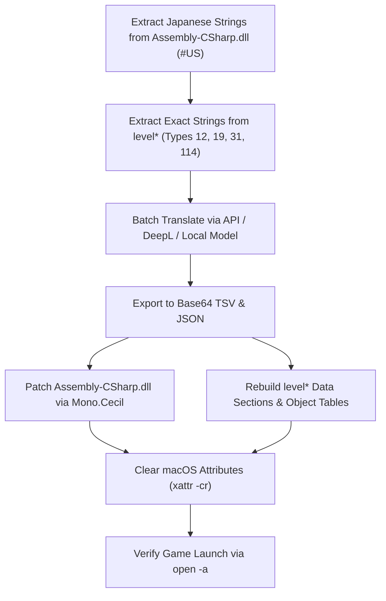

# Unity macOS Game Translation Pipeline (Automated Workflow)

A standardized, battle-tested recipe for translating Unity Mono games on macOS (Apple Silicon / Intel). Designed to be executed directly by autonomous agents (`rat`).

---

## 1. Core Architecture & Failure Modes

### Why BepInEx / Doorstop Fails on macOS
- When launched via Finder / LaunchServices (`open Game.app`), macOS System Integrity Protection (SIP) automatically strips `DYLD_INSERT_LIBRARIES` and `DYLD_LIBRARY_PATH`.
- Doorstop injection silently fails, leaving the game running unmodded in Japanese.
- **Solution**: **Direct Static Asset & IL Code Patching**. Zero runtime overhead, 100% native, bypasses Gatekeeper/SIP completely.

---

## 2. Technical Pitfalls & Critical Lessons Learned

### Pitfall A: Scene Files (`level*`) & Mesh Corruption
1. **Scene File Format**: Unity Serialized File (Version 21). Contains:
   - Big-endian Header (metadata size, file size, version, data offset).
   - Object Table (each entry: `path_id` [8B], `offset` [4B], `size` [4B], `type_id` [4B]).
   - Sequentially padded object payloads (8-byte alignment between objects).
2. **Strict Object Type Filtering**:
   - **Only patch Text / UI objects**: Type 12 (Text), Type 19/31 (TextMeshPro), Type 114 (MonoBehaviour).
   - **NEVER blindly search-replace bytes** in Type 1 (GameObject) or Type 7 (Mesh / AnimationClip). Binary vertex floats and transform matrices can coincidentally match UTF-8 sequences. Modifying them causes immediate fatal crash:
     ```
     The file 'levelX' is corrupted! [Position out of bounds!]
     ```
3. **Multi-line UI Labels**: Buttons and skill tooltips often contain literal line breaks (`\n`) and full-width numbers (e.g. `シックス\nナイン`, `エンド\n１`, `視点１`). String extractors must capture multi-line UTF-8 sequences.

### Pitfall B: Code Assemblies (`Assembly-CSharp.dll`) & The 64KB Ceiling
1. **`#US` (User String) Stream**:
   - In .NET metadata, strings are indexed by a 24-bit offset into the `#US` heap.
   - Compiled IL instructions use opcode `0x72` (`ldstr`):
     ```
     0x72 [b0] [b1] [b2] 0x70
     Token = 0x70000000 | (b2 << 16) | (b1 << 8) | b0
     ```
2. **The 16-bit Trap**:
   - Naive token regexes looking for `(..)\x00\x70` assume string offsets are under 64 KB.
   - Games with rich dialogue have `#US` heaps exceeding 200–500 KB. Any dialogue string after offset `0x10000` has a non-zero 3rd byte (`0x01`, `0x02`, etc.) and will be completely missed (~75% of dialogues).
   - **Fix**: Use `Mono.Cecil` to inspect all `Method.Body.Instructions` where `OpCode == OpCodes.Ldstr`, or scan full 24-bit offsets (`\x72(...)\x70`).
3. **JSON Escaping Pitfall**:
   - Japanese visual novel lines frequently contain quotes (`"..."`, `「...」`) and newlines (`\n`).
   - Using naive regex to parse JSON in C# corrupts multi-line keys.
   - **Fix**: Serialize translation dictionaries to **Base64-encoded TSV** (`<base64_ja>\t<base64_en>\n`).

---

## 3. Automated Step-by-Step Pipeline (For Rat / Agent)



### Step 1: Backup Original Files
```bash
cp Assembly-CSharp.dll Assembly-CSharp.dll.bak
mkdir -p level_backup && cp level* level_backup/
```

### Step 2: Extraction Script (`extract_strings.py`)
```python
import struct, re, json, os

def extract_dll_strings(dll_path):
    with open(dll_path, 'rb') as f: data = f.read()
    pos = data.find(b'#US\x00')
    stream_offset = int.from_bytes(data[pos-8:pos-4], 'little')
    bsjb = data.find(b'BSJB')
    us_offset = bsjb + stream_offset
    stream_size = int.from_bytes(data[pos-4:pos], 'little')
    us_data = data[us_offset : us_offset + stream_size]
    
    strings = set()
    p = 1
    while p < len(us_data):
        b = us_data[p]
        if b < 0x80: length = b; p += 1
        elif b < 0xc0: length = ((b & 0x3f) << 8) | us_data[p+1]; p += 2
        else: length = ((b & 0x1f) << 24) | (us_data[p+1] << 16) | (us_data[p+2] << 8) | us_data[p+3]; p += 4
        if length > 0:
            str_bytes = us_data[p : p + length - 1]
            try:
                s = str_bytes.decode('utf-16le')
                if re.search(r'[\u3040-\u30ff\u4e00-\u9fff]', s):
                    strings.add(s)
            except: pass
            p += length
    return strings
```

### Step 3: Batch Translation & TSV Export
Encode translations using Base64 to prevent escape errors:
```python
import base64
with open('translations.tsv', 'w', encoding='utf-8') as f:
    for k, v in translations.items():
        f.write(f"{base64.b64encode(k.encode('utf-8')).decode('ascii')}\t{base64.b64encode(v.encode('utf-8')).decode('ascii')}\n")
```

### Step 4: Patching `Assembly-CSharp.dll` with `Mono.Cecil`
Compile and run with `mcs` (Mono C# compiler) and `Mono.Cecil.dll`:
```csharp
using System;
using System.IO;
using System.Text;
using System.Collections.Generic;
using Mono.Cecil;
using Mono.Cecil.Cil;

class Patcher {
    static void Main(string[] args) {
        var dict = new Dictionary<string, string>();
        foreach (var line in File.ReadAllLines(args[1])) {
            var parts = line.Split('\t');
            if (parts.Length == 2)
                dict[Encoding.UTF8.GetString(Convert.FromBase64String(parts[0]))] =
                     Encoding.UTF8.GetString(Convert.FromBase64String(parts[1]));
        }
        var asm = AssemblyDefinition.ReadAssembly(args[0]);
        foreach (var type in asm.MainModule.Types)
            PatchType(type, dict);
        asm.Write(args[2]);
    }
    static void PatchType(TypeDefinition t, Dictionary<string, string> d) {
        foreach (var m in t.Methods) {
            if (m.HasBody) {
                foreach (var i in m.Body.Instructions) {
                    if (i.OpCode == OpCodes.Ldstr && i.Operand is string s && d.TryGetValue(s, out var en))
                        i.Operand = en;
                }
            }
        }
        foreach (var n in t.NestedTypes) PatchType(n, d);
    }
}
```

### Step 5: Patching Unity Scene Files (`level*`)
1. Read object table from metadata.
2. Filter objects: only process text-bearing types.
3. Replace `[int32 len] [utf-8 string] [pad]` with updated length and padding.
4. Recalculate 8-byte aligned offsets for data section.
5. Update offsets and sizes in the fixed 20-byte metadata entries.
6. Write updated total `file_size` to header.

### Step 6: Post-Patch Cleanup & Execution
```bash
xattr -cr "Game.app"
open -a "Game.app"
```
